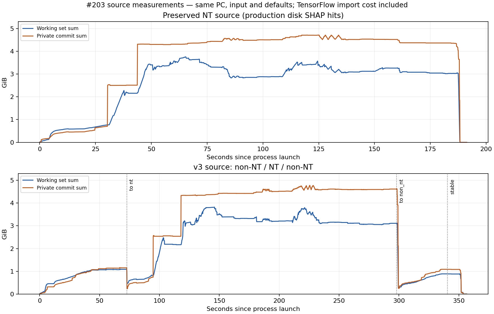

# #203 — 전체 프로세스 트리 RAM 실측

같은 PC·입력·기본 설정의 **소스 실행**에서 기본 non-NT의 전체 트리 working set
관측 피크는 **1,123.2MiB**, 보존된 기존 NT는 **3,843.0MiB**였다. 관측 감소율은
**70.77%**다. Private commit 피크는 **1,193.1MiB 대 4,825.7MiB**, **75.28% 감소**였다.
모델 파일 크기에서 추정하지 않았으며 합격용 절대 상한·목표 감소율을 만들지 않았다.

이 PC의 개발 환경에는 TensorFlow가 설치되어 있고 non-NT Keras 역직렬화 중 실제로
import된다. 이 비용을 포함한 결과다. TensorFlow가 없는 최종 패키지의 RAM 결과나
모든 입력·헤드·장시간 반복 사용에 대한 보장으로 확대하지 않는다.

## 실행본·환경·입력

실행 전 [등록 계약](benchmarks/issue203-ram-20261119-run02/contract.json)을 생성했다.
각 launch 기록에 계약 SHA와 실제 argv·cwd가 있고, 계약에는 제품 Python 파일과
실제 모델·tokenizer·사전계산 SHAP 자산 및 측정 도구의 SHA-256이 있다.

| 항목 | 실행 조건 |
|---|---|
| 기존 NT | `xai_dashboard_desktop`, `dashboard_core_v2`, `9d680575212ad343f060570ea0490ff53ebc2473` |
| v3 | `dashboard_v3`, `a1d0b6151fb88979bef9d28f3651e560e73018ff` |
| PC | SJun, Windows 11 build 26200, Intel i5-8265U, 4코어/8스레드, RAM 8,373,960,704 bytes |
| 공통 런타임 | Python 3.13.7, torch 2.12.0+cpu, transformers 5.8.1, numpy 2.3.2, SHAP 0.52.0 |
| non-NT | Keras 3.14.1, torch backend, h5py 3.14.0; TensorFlow 2.21.0 import 비용 포함 |
| UI/측정 | pywebview 6.2.1, pythonnet 3.2.1, WebView2 157.0.4341.60, psutil 7.2.2 |
| 고정 DNA | `CAAAGTAGCCGGTCGCTTTAAGAATAAATAAAAGCGCCACAGGATTGACTAAACCACAGCCGGCGCCCTGGCCCCCTACCG` |
| 설명 대상 | `SpCas9|+|32` / `SpCas9-NG`, `Cas12a|+|16` / `Cas12a` |
| 설정 | CPU thread 4, IG 32, SHAP 64샘플·배경4, 그래프80%; NT만 Rollout 지원 |

두 계열은 각자의 실제 모델 윈도우·단위·캐시 정책으로 실행한다. 기존 NT의 단위
오류를 재현해야 v3와 동등하다고 보지 않는다. 화면 렌더 성공을 XAI 수치 품질
검증 성공으로 보고하지 않으며 기존 #199/#200/#201 품질 기록은 유지한다.

## 단계별 결과

표의 단위는 MiB다. 각 칸은 **working set 피크 / private commit 피크**다. 두 지표의
최댓값은 서로 다른 시각일 수 있다. 단계마다 모델·UI·WebView2 전체 트리 및 이미
보유한 예측·설명·그림 캐시를 포함한다. 공유 페이지가 중복될 수 있는 working set
합을 중복 없는 물리 RAM이라고 부르지 않는다. Private commit은 paging된 메모리도
포함하므로 resident RAM과 구분한다.

| 단계 | 기존 NT 기본 실행 | v3 기본 non-NT | v3 NT 전환 후 |
|---|---:|---:|---:|
| 시작·준비 | 2,330.6 / 2,591.0 | 467.7 / 325.5 | 2,507.3 / 2,631.5 |
| 예측 | 3,831.7 / 4,419.9 | 1,018.9 / 985.8 | 3,857.8 / 4,461.9 |
| SpCas9 IG | 3,406.7 / 4,674.1 | 1,093.6 / 1,143.3 | 3,394.5 / 4,718.3 |
| SpCas9 SHAP | 2,950.9 / 4,612.0 | 1,105.6 / 1,167.1 | 3,912.1 / 4,625.0 |
| SpCas9 Rollout | 3,843.0 / 4,542.2 | 미지원 | 3,295.9 / 4,632.8 |
| Cas12a IG | 3,655.5 / 4,825.7 | 1,106.3 / 1,167.4 | 3,888.7 / 4,888.6 |
| Cas12a SHAP | 3,196.1 / 4,643.2 | 1,123.2 / 1,193.1 | 3,235.4 / 4,726.0 |
| Cas12a Rollout | 3,357.8 / 4,641.6 | 미지원 | 3,184.1 / 4,726.3 |
| 위 흐름 전체 피크 | **3,843.0 / 4,825.7** | **1,123.2 / 1,193.1** | **3,912.1 / 4,888.6** |

각 기법·사이트가 여러 번 나타나면 해당 구간들의 관측 최댓값을 쓴다. v3 SpCas9
SHAP의 working set 피크와 private commit 피크도 서로 다른 호출에서 발생했다.
예측 직후 제품이 자동으로 실행하는 설명과 이후 명시적 선택을 모두 원시 단계에
남겼다. 동일 기법 재선택으로 캐시가 적중한 호출을 새 계산으로 보고하지 않는다.

기존 NT의 두 SHAP은 디스크 캐시에 적중했다. 따라서 위 SHAP 행은 기본 실행의
캐시 읽기·그림 표시 비용이다. v3 NT는 두 SHAP을 실제 계산했고 디스크 조회는 0회다.
기존 NT의 새 SHAP 계산은 별도 사전 등록한
[추가 실험](benchmarks/issue203-ram-20261119-cold01/summary.json)으로 측정했다.
원본 소스와 사전계산 파일은 변경하지 않고 lookup만 미적중으로 처리했다.

| 추가 실험 단계 | 기존 NT, 디스크 SHAP 미적중 (working set / private commit MiB) |
|---|---:|
| SpCas9 SHAP 새 계산 | 2,927.5 / 4,615.8 |
| Cas12a SHAP 새 계산 | 3,085.7 / 4,682.2 |
| 전체 흐름 피크 | 3,888.8 / 4,852.0 |

두 SHAP 진입·디스크 조회는 각 2회, 디스크 적중은 **0회**였다. 이 추가 실험의
전체 흐름 피크를 기준으로도 기본 non-NT는 working set **71.12%**, private commit
**75.41%** 낮았다. SHAP 새 계산의 working set이 캐시 적중 실행보다 꼭 높지는 않다.
서로 다른 실행의 resident 값에는 paging·보유 상태가 반영되므로 private commit도
함께 제시한다. 추가 실험은 **2,669 sample / 270.21초**, 실제 최대 간격 **0.379초**였고
접근 오류·timeout·종료 후 잔여 프로세스는 0개였다.



## NT에서 non-NT로 복귀

기본 non-NT 작업 PID **14732** → NT **22444** → 복귀 non-NT **544**로 교체되었다.
각 이전 작업 프로세스와 전환 직전 자손은 종료되었다. 전체 원시 sample에서 계산
프로세스의 최대 동시 관측 수는 **1**, 복귀 안정 구간 이후 NT PID 관측 수는 **0**이다.
프로세스 종료로 이전 모델·tokenizer·gradient·캐시의 주소 공간이 사라지는 것을
확인했다. OS 파일 캐시를 앱의 잔여 모델 적재라고 부르지 않는다.

- 처음과 복귀 후의 두 예측기는 모두 non-NT 클래스이며 `_runtime`은 적재 상태다.
  NT `_model`·`_tokenizer`는 모두 미적재다. NT 구간에서는 두 NT 모델과 tokenizer가
  실제로 적재되어 있어, NT를 건너뛴 전환 검사가 아니다.
- 모든 v3 UI 관찰에서 torch/Keras/TensorFlow/transformers/tokenizers/numpy/
  matplotlib는 미로딩이다. 모델·gradient·그림은 계산 프로세스에서 실행된다.
- 복귀 후 10초 안정 구간의 마지막 2초 중앙값은 **902.9MiB working set /
  1,108.0MiB private commit**이다. 마지막 2초의 최소·최대도 각각 이 값과 같았다.
- 동일한 자동 Cas12a IG 완료 직후의 최초 non-NT 상태와 비교하면 working set은
  **176.8MiB 낮고**, private commit은 **8.6MiB 높다**. 정확히 같은 바이트 수로
  돌아온 결과는 아니다. UI/WebView 상태와 paging 영향이 있으므로 working set
  차이를 가중치 회수량으로 역산하지 않는다. 작은 차이의 원인이나 반복 전환의
  장기 누수 여부는 이 단일 실행으로 확정하지 않는다.
- 전환 시작은 아직 이전 NT가 살아 있는 시점이다. 복귀 호출 단계의 피크
  **3,192.3 / 4,731.8MiB**는 별도로 보존하며 non-NT 기본 피크에 섞지 않는다.

기존 NT는 발견한 프로세스 12개, v3는 실행 전체에서 17개를 추적했다. 양쪽 모두
WebView2 browser/renderer/GPU/utility와 UI를 포함한다. 제품의 JSON pipe 직렬화·복사,
PNG/base64/HTML, 브리지 전달·이미지 decode·렌더링, 캐시 및 실제로 import된 보조
런타임의 비용을 제외하지 않았다. 각 앱 종료 후 잔여 프로세스는 0개다.

## 원시 자료·명령·검증 범위

[재사용 절차](benchmarks/ram-procedure.md)에 실제 등록·실행·요약·분석 명령을 남겼다.
[기본 비교 단계별 요약](benchmarks/issue203-ram-20261119-run02/summary.json)과
[수명·미적재 및 감소율 분석](benchmarks/issue203-ram-20261119-run02/comparison.json)은
각 폴더의 `samples.jsonl.gz`, `phases.jsonl`, `runtime-*.jsonl`, `window.json`,
`sampler.json`, `window.log`, `launch.json`에서 재계산할 수 있다.

기본 실행은 기존 NT **1,890 sample / 191.32초**, v3 **3,531 sample / 356.59초**다.
100ms 목표 간격에 대한 실제 최대 간격은 각각 **0.670초 / 0.281초**였다. 따라서
이보다 짧은 피크를 보장하지 않는다. 접근 오류·timeout·최종 잔여 자식은 모두 0개다.
최초 [run01](benchmarks/issue203-ram-20261119-run01/README.md)은 Rollout 그래프 수를
잘못 검사해 중단된 측정 도구 실패로 보존한다. 제품의 실패로 해석하지 않는다.

관련 회귀 경계는 `DesktopApi`/계산 프로세스의 계열 전환·IPC·자식 수명이다.
전체 저장소 테스트는 실행하지 않는다. 아래 수는 각 실행을 합산하지 않고 기록한다.

| 실제 명령 | 결과 |
|---|---|
| `py -3.13 -X utf8 -m pytest tests/test_family_switch.py -q -p no:cacheprovider` | 10 통과 / 0 실패 / 0 건너뜀 |
| `py -3.13 -X utf8 -m pytest tests/test_family_switch.py tests/test_computation_process.py -q -p no:cacheprovider` | 최종 회귀 20 통과 / 0 실패 / 0 건너뜀; 26.85초 |
| 절차의 `run ...run02 legacy` | 창 검사 6 통과 / 0 실패 / 0 건너뜀, exit 0 |
| 절차의 `run ...run02 v3` | 창 검사 16 통과 / 0 실패 / 0 건너뜀, exit 0 |
| 절차의 `run ...cold01 legacy` | 창 검사 6 통과 / 0 실패 / 0 건너뜀, exit 0 |
| 절차의 `analyze_ram.py ...run02 --cold ...cold01` | 원시 자료·수명·미적재·캐시 조건 검사 15 통과 / 0 실패 / 0 건너뜀 |

정적 검사는 다음 실제 명령으로 **0 errors / 0 warnings**, Ruff 통과였다.

```powershell
py -3.13 -m pyright docs/benchmarks/measure_ram.py docs/benchmarks/ram_window.py docs/benchmarks/ram_worker.py docs/benchmarks/analyze_ram.py docs/benchmarks/plot_ram.py
py -3.13 -m ruff check --select F,E9 docs/benchmarks/measure_ram.py docs/benchmarks/ram_window.py docs/benchmarks/ram_worker.py docs/benchmarks/analyze_ram.py docs/benchmarks/plot_ram.py
py -3.13 -X utf8 docs/benchmarks/plot_ram.py docs/benchmarks/issue203-ram-20261119-run02
```

Git의 자동 줄바꿈 변환을 발견해 `.gitattributes`로 등록 계약·원시 자료·해시 대상
관찰 도구의 바이트를 고정했다. 실제 측정 파일은 변경하지 않았다. 보관 검사기는
다음 명령으로 Git blob과 등록 observer·launch 계약 해시의 일치를 확인한다.
커밋 전 `--staged` 검사에서 **13 통과 / 0 실패 / 0 건너뜀**이었다.

```powershell
py -3.13 -X utf8 docs/benchmarks/verify_ram_archive.py --staged
py -3.13 -X utf8 docs/benchmarks/verify_ram_archive.py
```

별도 sampler 점검은 실제 Python 부모 8MiB·자식 24MiB 할당을 실행해 두 Python
프로세스 관측·할당을 포함한 private peak·정상 종료 **3 통과 / 0 실패 / 0 건너뜀**이었다.
[점검 자료](benchmarks/issue203-sampler-smoke/README.md)에 실제 명령·검사식을 남겼다.
처음 점검 질의는 conhost까지 포함한 총 프로세스 수를 2라고 잘못 가정해 실패했고,
두 Python 프로세스로 검사 범위를 고쳤다. sampler 구현은 바꾸지 않았다.

소스 이외의 실행본은 이 티켓에서 측정하지 않았다. 최종 배포본 RAM·깨끗한 오프라인
Windows는 **미검증**이며 #204에서 실행본을 새로 식별하고 같은 전체 트리 측정 절차를
적용한다. TensorFlow가 없는 패키지에서 얻을 결과를 이번 소스 결과로 대체하지 않는다.
