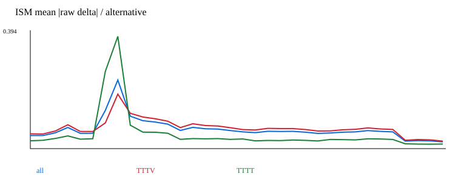
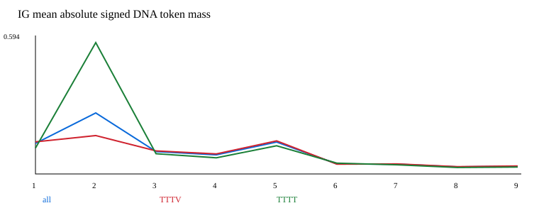
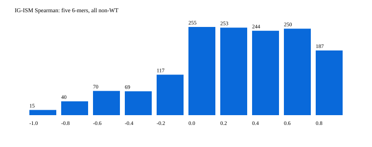

# Cas12a NT Test 본 분석 결과

기존 내부 Testset에 대한 native FP32 단일 출력 분석입니다.

- Test 모집단: 1500행
- 분석 완료: True
- IG 통계 모집단: full, 1500행. 사례 전용 ID는 통계에서 제외합니다.
- raw/clipped 단위: fraction. 기존 분할·학습 완료 모델을 사용합니다.

## 방법별 실제 coverage

|방법|요구|성공|실패|미계산|
|---|---:|---:|---:|---:|
|prediction|1500|1500|0|0|
|ism|1500|1500|0|0|
|rollout|1500|1500|0|0|
|ig|1500|1500|0|0|

## 예측 성능

|PAM 집단|view|n|Spearman|Pearson|MAE|MSE|
|---|---|---:|---:|---:|---:|---:|
|all|raw|1500|0.7007166054479692|0.7028181972397527|0.17604893846011013|0.05261078807291251|
|all|clipped|1500|0.7007132546530073|0.7027989399914893|0.17582210791724648|0.05259015049471287|
|TTTV|raw|1135|0.542273730381114|0.5550987395957416|0.19519064643566303|0.06015155342204406|
|TTTV|clipped|1135|0.5422728976675405|0.5549837870620066|0.19512530033696524|0.060148073130631044|
|TTTT|raw|365|0.2994548712119873|0.3842087611132381|0.11652609311147304|0.029162106781777396|
|TTTT|clipped|365|0.29960037573771237|0.3849447743003282|0.11579711231072373|0.029088117092611113|

## 설명과 IG–ISM 일치도

주 통계는 같은 길이 t1–t5의 6-mer, PAM-breaking 포함, density Spearman입니다. 유효 1500/1500행, 중앙값 0.3999999999999999.
9-token, PAM-breaking 제외, mass/span-sum, 평균 profile과 길이·순수 flank군의 global rank 및 within/between 기여는 agreement.json에 기록합니다.
주 통계는 마지막 protospacer 1bp를 제외하며 PAM 혼합 토큰은 포함합니다. PAM-breaking 제외 분석은 IG와 ISM의 지지 범위가 다를 수 있습니다.
낮은 상관은 설명 정확도 실패가 아닙니다. 정상 zero norm과 undefined는 이유와 함께 보존하며 실패·미계산 IG를 0으로 채우지 않습니다.
IG zero reference는 분포 내 경로를 보장하지 않습니다. special attribution과 completeness/convergence는 IG sidecar에 별도로 기록합니다.

## 기술 사례

raw 범위 이탈→높은 오차→낮은 오차 순으로 각 최대 5개, 중복 제외·미충원입니다. 예측과 라벨로만 선정하며 설명값으로 재선정하지 않습니다.
cases.csv와 cases_annotated.json에서 source ID별 선정 이유, IG/ISM/rollout의 상태와 설명을 확인할 수 있습니다.

- source 12685, out_of_range: raw=-0.0756729, label=0.00611289, |error|=0.0817857; ism: available, ig: available, rollout: available; ISM 최대 위치=5 (0-based), PAM sensitivity 비중=0.15576748478819016
- source 10345, out_of_range: raw=-0.0529448, label=0, |error|=0.0529448; ism: available, ig: available, rollout: available; ISM 최대 위치=21 (0-based), PAM sensitivity 비중=0.10428020363483653
- source 12347, out_of_range: raw=-0.0406656, label=0.0415305, |error|=0.0821961; ism: available, ig: available, rollout: available; ISM 최대 위치=7 (0-based), PAM sensitivity 비중=0.3705210828813251
- source 13377, out_of_range: raw=-0.0357564, label=0, |error|=0.0357564; ism: available, ig: available, rollout: available; ISM 최대 위치=3 (0-based), PAM sensitivity 비중=0.24540930934248495
- source 12637, out_of_range: raw=-0.0230934, label=0.0307909, |error|=0.0538843; ism: available, ig: available, rollout: available; ISM 최대 위치=7 (0-based), PAM sensitivity 비중=0.5376890473666585
- source 13768, high_error: raw=0.132649, label=0.975124, |error|=0.842476; ism: available, ig: available, rollout: available; ISM 최대 위치=7 (0-based), PAM sensitivity 비중=0.5216929909669606
- source 6021, high_error: raw=0.0591588, label=0.86194, |error|=0.802782; ism: available, ig: available, rollout: available; ISM 최대 위치=12 (0-based), PAM sensitivity 비중=0.11480469017444961
- source 13338, high_error: raw=0.217325, label=0.998679, |error|=0.781354; ism: available, ig: available, rollout: available; ISM 최대 위치=7 (0-based), PAM sensitivity 비중=0.4042275423589936
- source 13605, high_error: raw=0.181174, label=0.957319, |error|=0.776144; ism: available, ig: available, rollout: available; ISM 최대 위치=7 (0-based), PAM sensitivity 비중=0.45951356707310076
- source 6718, high_error: raw=0.742763, label=0, |error|=0.742763; ism: available, ig: available, rollout: available; ISM 최대 위치=7 (0-based), PAM sensitivity 비중=0.22853350953313784
- source 13121, low_error: raw=0.00241904, label=0.00232019, |error|=9.88556e-05; ism: available, ig: available, rollout: available; ISM 최대 위치=7 (0-based), PAM sensitivity 비중=0.3882807918684775
- source 2236, low_error: raw=0.663098, label=0.662937, |error|=0.000161219; ism: available, ig: available, rollout: available; ISM 최대 위치=21 (0-based), PAM sensitivity 비중=0.1387525423989415
- source 2645, low_error: raw=0.531506, label=0.531343, |error|=0.0001633; ism: available, ig: available, rollout: available; ISM 최대 위치=7 (0-based), PAM sensitivity 비중=0.1657309521933343
- source 11408, low_error: raw=0.200764, label=0.200597, |error|=0.00016773; ism: available, ig: available, rollout: available; ISM 최대 위치=6 (0-based), PAM sensitivity 비중=0.28192216463988584
- source 12995, low_error: raw=0.0259998, label=0.0257019, |error|=0.000297851; ism: available, ig: available, rollout: available; ISM 최대 위치=7 (0-based), PAM sensitivity 비중=0.4086648312911716

## rollout 해석

encoder token attention flow입니다. CLS를 유지해 전파한 뒤 DNA 블록을 추출하며 재정규화하지 않습니다. 제거된 CLS 질량과 query 유사성 진단은 rollout_diagnostics.json에 저장합니다. 출력 attribution이나 선택적 토큰 쌍 상호작용을 입증하지 않습니다.

rollout 품질 통과 1500/1500행 중 DNA query가 거의 동일한 행은 1500행입니다.

## 범위와 한계

TTTV/TTTT는 관측된 각 집단의 행 수를 분모로 사용합니다. 표본 IG의 PAM 차이는 탐색적입니다. 부분 결과는 실제 성공 coverage만 설명하며 전체 완료로 표시하지 않습니다.
validation 근거와 이 Test 결과는 별도입니다. 과거 FP16 평가와 FP32의 동등성을 주장하지 않습니다.
사용자 승인에 따라 본 분석은 과거 검증 실행의 시간 초과 차단과 분리했습니다. 기존 study·receipt·charge와 종료 시각은 변경하거나 정산하지 않습니다. 새 실행의 세션별 경과 시간은 별도로 기록합니다.
